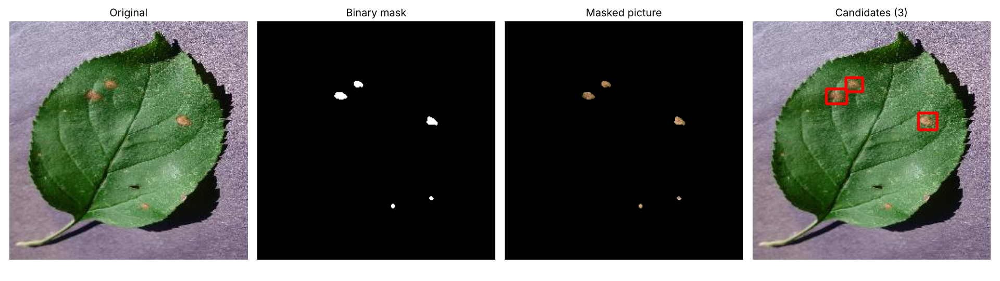

# Fungal Lesion Detection on Apple Leaves

**Using Convolutional Neural Networks on Hue-Saturation-Value Segmented Images**

CSUB Senior Project, 2026–2027

**Team:** Andrew Rivera · Arvin Gill · Demetrio Rodriguez Sandoval · Jonathan Torres

---

## What this project does

This project will test whether HSV segmentation improves a CNN-based object detector’s ability to locate and identify fungal lesions on apple leaves. We use PlantVillage’s apple scab, black rot, cedar apple rust, and healthy categories.

## Planned detection workflow
* 1. Load an original color apple-leaf image.
* 2. Convert the image to HSV.
* 3. Apply the selected HSV ranges and combine their results into a binary mask. Use the same preprocessing procedure for every image without using its known disease label to choose thresholds.
* 4. Apply the mask to the original image, preserving selected pixels in their original colors and making excluded pixels black.
* 5. Feed the full masked color image into a CNN-based object detector, which predicts lesion-box coordinates, disease labels, and confidence scores.
* 6. Draw the accepted predictions on the original image.
During training, manually annotated lesion boxes and disease labels provide the reference answers. These annotations are stored separately from the images. Healthy images have no lesion boxes.

**Baseline:** Train two instances of the same detector architecture: one on original color images and one on HSV-masked color images. Use the same image splits, reference annotations, and comparable training settings.
Select each run’s checkpoint using validation performance, then compare the selected checkpoints on the same held-out test set.

## Repository layout

```
apple-lesion-detection/
├── README.md               This file
├── requirements.txt        Python packages
├── .gitignore              Keeps data, models, and caches out of Git
├── annotation/             Lesion labeling guide and CVAT label file
├── data/                   Datasets (not committed; see data/README.md)
├── docs/                   Development environment summary and example figures
├── models/                 Saved model weights (not committed)
├── notebooks/              Jupyter notebooks (HSV demo)
├── outputs/                Figures and results (not committed)
├── scripts/                Environment check and dataset download
├── src/
│   ├── hsv/                HSV thresholds, masks, candidate boxes
│   ├── cnn/                Region classifier model
│   └── eval/               IoU and lesion matching (found, missed, false alarms)
└── tests/                  Unit tests (pytest)
```

## Setup

Requires **Python 3.10 or newer** and **Git**.

```bash
git clone https://github.com/<your-org>/apple-lesion-detection.git
cd apple-lesion-detection

python -m venv .venv
# Windows:      .venv\Scripts\activate
# macOS/Linux:  source .venv/bin/activate

pip install -r requirements.txt
python scripts/check_env.py
```

`check_env.py` prints each package version and whether a GPU is available.

### Google Colab

Open a notebook, set **Runtime → Change runtime type → GPU**, then run:

```python
!git clone https://github.com/<your-org>/apple-lesion-detection.git
%cd apple-lesion-detection
!pip install -q -r requirements.txt
!python scripts/check_env.py
```

## Get the data

We use the four apple classes from PlantVillage (3,171 images, about 52 MB):

| Class | Images |
| --- | --- |
| `Apple___Apple_scab` | 630 |
| `Apple___Black_rot` | 621 |
| `Apple___Cedar_apple_rust` | 275 |
| `Apple___healthy` | 1,645 |

```bash
python scripts/download_plantvillage.py            # all apple images, takes seconds
python scripts/download_plantvillage.py --limit 20 # quick test: 20 per class
```

The script needs `git`. It downloads only the apple folders from the
[original PlantVillage repository](https://github.com/spMohanty/PlantVillage-Dataset).
These are the same images as the
[Hugging Face copy](https://huggingface.co/datasets/mohanty/PlantVillage), but
that copy runs a loader script that downloads the full 2 GB dataset and does
not work with `datasets` 4.0 or newer.

Images are saved to `data/raw/plantvillage_apple/{train,val,test}/<class>/`
(about 70/15/15). `manifest.csv` records each image's `leaf_id`; splits are made
by leaf, so the same physical leaf never appears in both training and test sets.

## Run the HSV demo

```bash
python -m src.hsv.demo --synthetic   # no data needed
python -m src.hsv.demo --image data/raw/plantvillage_apple/train/Apple___Black_rot/<file>.JPG
python -m src.hsv.demo --image <rust leaf> --disease cedar_apple_rust
```

This saves `outputs/hsv_demo.png` with four panels: original, binary mask,
masked picture, and candidate boxes. `--disease` uses only that disease's
thresholds. The notebook `notebooks/01_hsv_demo.ipynb` walks through the same
steps one cell at a time.



*Black rot thresholds on a PlantVillage leaf: original, binary mask, masked
picture, candidate boxes.*

### Known issue: scab thresholds

Rust and black rot lesions are far from green in hue and separate cleanly.
Scab lesions are olive-green, inside the healthy hue band, and differ mainly by
being darker, so the scab range also selects shadowed healthy tissue. Tuning
the scab range, or letting the CNN reject those regions, is an open task.

## Run the tests

```bash
pytest -q
```

## Lesion labeling

No public dataset we found has boxes around individual lesions, so we label
them ourselves. See [`annotation/LABELING_GUIDE.md`](annotation/LABELING_GUIDE.md).

## Team roles

| Member | Lead area |
| --- | --- |
| Andrew Rivera | Data and annotation |
| Arvin Gill | HSV segmentation |
| Demetrio Rodriguez Sandoval | CNN models |
| Jonathan Torres | Evaluation and integration |

## Working together

- Work on a branch (`git checkout -b arvin/hsv-thresholds`), then open a pull
  request into `main`.
- Never commit datasets, model weights, or large outputs; `.gitignore` covers
  the usual folders.
- Track tasks in GitHub Issues.

## Data source

Mohanty, S. P., Hughes, D. P., & Salathé, M. (2016). Using deep learning for
image-based plant disease detection. *Frontiers in Plant Science*, 7, 1419.
Dataset licensed CC BY-SA 3.0.
